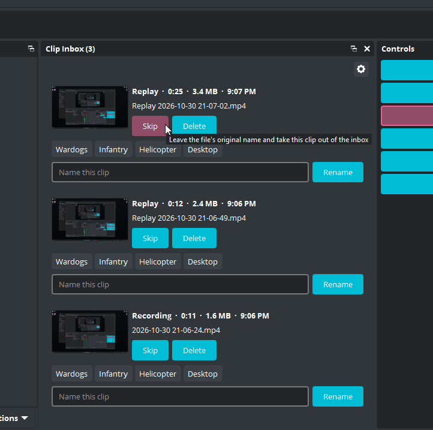
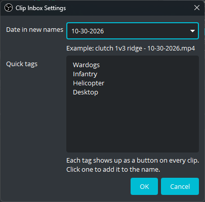

# Clip Inbox

An OBS Studio dock where every new recording and replay waits for a name.



OBS names files by date and time, like `Replay 2026-10-30 14-22-05.mp4`. By the time I sit down to edit, usually a day or two later, I can't tell my clips apart without opening every one of them. So I built Clip Inbox. Clips quietly pile up in a dock while I play, and when I'm done I give each one a real name, skip it, or delete it, while the moments are still fresh.

## Features

- Every saved replay and finished recording lands in the inbox, newest first
- Type a name and press Enter (or click Rename), and the file becomes `clutch 1v3 ridge - 2026-10-30.mp4`
- Each clip shows its thumbnail, length, size, and when it was recorded, so you know what you're naming
- Quick tags: your own words, like game names, as one-click buttons on every clip
- Pick how the date looks in names, or leave it off
- Delete sends clips to the Recycle Bin, so nothing is gone for good
- Never pops up during gameplay and never steals focus from your game
- The inbox survives closing OBS

## Install

1. Download the latest `clip-inbox-…-windows-x64-installer.exe` from [Releases](https://github.com/Vultify/clip-inbox/releases).
2. Close OBS Studio, then run the installer.
3. Open OBS Studio and click **Docks → Clip Inbox**. Drag the dock wherever you like, next to Scenes and Sources works well.

Windows may show a blue "Windows protected your PC" screen because the installer isn't code-signed yet. Click **More info**, then **Run anyway**.

### Requirements

- Windows 10 or 11, 64-bit
- OBS Studio 31.1.1 or newer (OBS 33's new plugin layout is supported)

## Using it

Record and save replays the way you always do. Each finished clip shows up in the inbox a couple of seconds after OBS is done writing it. For each clip you can:

- **Rename:** type a name, then press Enter or click **Rename**. The clip leaves the inbox.
- **Skip:** leave the original file name and take the clip out of the inbox.
- **Delete:** send the file to the Recycle Bin after a confirmation.

The gear button at the top of the dock opens the settings:



- **Date in new names:** `2026-10-30`, `10-30-2026`, `30-10-2026`, `Oct 30 2026`, or no date.
- **Quick tags:** one per line. Each becomes a button on every clip that adds that word to the name.

## How it keeps your recordings safe

- Files are renamed in the same folder, never moved.
- A name that's already taken gets ` (2)`, ` (3)`, and so on. Nothing is ever overwritten.
- Characters Windows doesn't allow in file names are cleaned out, and empty names are refused.
- Clips only appear once OBS has finished writing them. With "Automatically remux to mp4" on, the inbox shows the final `.mp4`.
- If another app has a clip open, the rename waits and finishes on its own once the file is free.
- Delete only ever uses the Recycle Bin. When Windows can't recycle a file (it's too big for the bin, or the drive doesn't have one), Clip Inbox leaves it alone and tells you.

Thumbnails and lengths come from Windows, the same way File Explorer gets them. HEVC and AV1 recordings need the matching video extension from the Microsoft Store for thumbnails to show. H.264 always works.

## Uninstall

Open **Windows Settings → Apps → Installed apps**, find **Clip Inbox for OBS Studio**, and click **Uninstall**.

Your inbox list and settings stay in `%APPDATA%\obs-studio\plugin_config\clip-inbox` in case you reinstall. Delete that folder to remove them too.

## Building from source

You'll need Visual Studio 2022 Build Tools (C++ workload and Windows SDK 10.0.22621), CMake 3.28 or newer, and Inno Setup 6 for the installer.

```
cmake --preset windows-x64
cmake --build --preset windows-x64
ctest --test-dir build_x64 -C RelWithDebInfo
```

The first configure downloads the OBS sources, OBS's prebuilt dependencies, and Qt into `.deps`.

## License

GPL-2.0, the same as OBS Studio. See [LICENSE](LICENSE).
